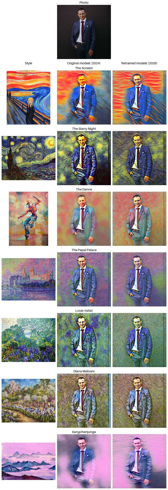

# StyleMorph

A Streamlit app that applies an artistic style to an uploaded photo with fast neural style transfer.
Each of the seven styles is a separate feed-forward network exported to ONNX, so stylization runs on CPU in a fraction of a second.
Photos are downscaled to 512 px on the long side before stylization.

## Example


## Styles
The Scream, The Starry Night, The Dance, The Papal Palace, Louis Valtat, Diana Malivani, Kangchenjunga.

The app has two versions of the models, picked with the "Model version" switch:
- **Retrained (2026)**, the default — `models/v2/style1.onnx` … `style7.onnx`. Trained with the code in `training/` on 4498 COCO images
  (people, cities, interiors, animals), 40,000 images per style, batch 4, style image at 512 px, best checkpoint by validation loss.
  They keep faces and skin tones better than the original models.
- **Original (2024)** — `models/epoch_*.onnx`, trained in `StylusFusion.ipynb` on 360 landscape photos for 200 or 500 epochs.

`.model` files next to the ONNX models are the matching PyTorch checkpoints. `images/style_images/` holds the style images.

| Style | Image | Style weight (retrained) |
|---|---|---|
| The Scream | `style1.jpg` | 5e4 |
| The Starry Night | `style2.jpg` | 5e4 |
| The Dance | `style3.jpg` | 1e5 |
| The Papal Palace | `style4.jpg` | 5e4 |
| Louis Valtat | `style5.jpg` | 3e4 |
| Diana Malivani | `style6.jpg` | 5e4 |
| Kangchenjunga | `style7.jpg` | 5e4 |

## Running locally
```bash
pip install -r requirements.txt
streamlit run app.py
```

## Docker
```bash
docker build -t stylemorph .
docker run -p 8501:8501 stylemorph
```
The app is then available at http://localhost:8501.

## Tests
```bash
pip install -r requirements-dev.txt
python -m pytest tests/
```
Tests of the training code run only when the packages from `requirements-train.txt` are installed, otherwise they are skipped.

## Training
Training runs from `training/` on [COCO val2017](https://cocodataset.org/) images; the dataset is not in git.
The train/val/test split lists are in `training/splits/coco_val2017/`.
```bash
pip install -r requirements-train.txt
mkdir -p data/coco && curl -L -o data/coco/val2017.zip http://images.cocodataset.org/zips/val2017.zip
unzip -q data/coco/val2017.zip -d data/coco

# Train one style: losses.csv, losses.png, best.model (lowest val loss) and samples/ go to the run directory
python -m training.train --style images/style_images/style2.jpg --out runs/starry

# Export to ONNX and check it against PyTorch
python -m training.export_onnx runs/starry/best.model runs/starry/best.onnx

# Compare models side by side on the 12 test images
python -m training.compare_grid --out runs/starry_compare.jpg \
    old=models/epoch_500_1_100000.0_style2.onnx new=runs/starry/best.onnx
```
`python -m training.train --help` lists the options: style image size, style weight, number of images, batch size and others.
The training device is picked automatically (CUDA, Apple MPS or CPU); `--amp` trains in mixed precision on CUDA
(1.3× faster on an RTX 2080 Ti with the same results). The retrained models took about 13 minutes per style on that GPU.

## How it works
The image transformation network and the perceptual losses (VGG16 content loss and Gram-matrix style loss) follow
Johnson et al., [Perceptual Losses for Real-Time Style Transfer and Super-Resolution](https://arxiv.org/abs/1603.08155) (ECCV 2016).
The network and training code are adapted from the PyTorch
[fast_neural_style example](https://github.com/pytorch/examples/tree/main/fast_neural_style) (BSD-3-Clause).
The original models were trained in `StylusFusion.ipynb`; the retrained ones with the scripts in `training/`.
