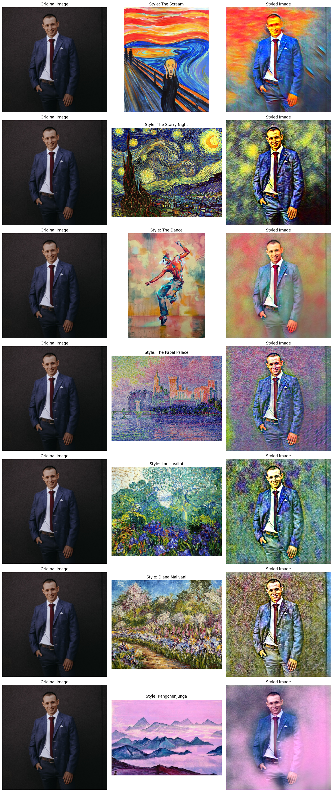

# StyleMorph

A Streamlit app that applies an artistic style to an uploaded photo with fast neural style transfer.
Each of the seven styles is a separate feed-forward network exported to ONNX, so stylization runs on CPU in a fraction of a second.
Photos are downscaled to 512 px on the long side before stylization.

## Example


## Styles
The Scream, The Starry Night, The Dance, The Papal Palace, Louis Valtat, Diana Malivani, Kangchenjunga.

- `images/style_images/` — style images.
- `models/*.onnx` — models used by the app; `models/*.model` — the matching PyTorch checkpoints.

## Running locally
```bash
pip install -r requirements.txt
streamlit run app.py
```

## Docker
```bash
docker build -t stylemorph .
docker run -p 8501:8501 stylemorph
```
The app is then available at http://localhost:8501.

## Tests
```bash
pip install -r requirements-dev.txt
python -m pytest tests/
```

## How it works
The image transformation network and the perceptual losses (VGG16 content loss and Gram-matrix style loss) follow
Johnson et al., [Perceptual Losses for Real-Time Style Transfer and Super-Resolution](https://arxiv.org/abs/1603.08155) (ECCV 2016).
The network and training code are adapted from the PyTorch
[fast_neural_style example](https://github.com/pytorch/examples/tree/main/fast_neural_style) (BSD-3-Clause).
Training is described in `StylusFusion.ipynb`.
